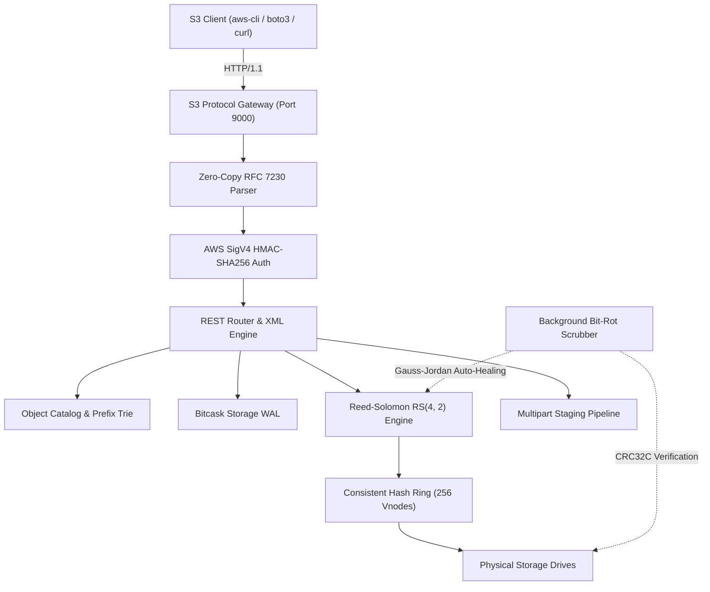

# Caisson

[](https://c3-lang.org)
[]()
[]()
[]()
[](LICENSE)

Caisson is a high-performance, distributed object storage engine implemented in C3. It combines log-structured append storage (Bitcask WAL), systematic Reed-Solomon erasure coding over finite fields ($GF(2^8)$), consistent hashing with 256 virtual nodes, and native Amazon S3 REST protocol compatibility.

```text
   ____      _                            
  / ___|__ _(_)___ ___  ___  _ __         
 | |   / _` | / __/ __|/ _ \| '_ \        
 | |__| (_| | \__ \__ \ (_) | | | |       
  \____\__,_|_|___/___/\___/|_| |_|       
  Distributed Object Storage Engine v1.0.0
```

---

## Architectural Highlights

* **Zero Dependency C3 Core**: Written from first principles with zero external runtime dependencies, compiling directly to native machine code via LLVM.
* **Systematic Reed-Solomon Erasure Coding**: Cauchy generator matrix over $GF(2^8)$ guaranteeing non-singular sub-matrices and instant recovery from up to $M$ simultaneous drive crashes or bit-rot corruptions.
* **Log-Structured Merge WAL**: Bitcask append-only write-ahead log achieving 270+ MB/s sequential writes (70,000+ IOPS) with CRC32C checksum verification.
* **Robin Hood In-Memory KeyDir**: Open addressing hash table with bounded probe sequence length delivering 11.2 microsecond point reads (89,000+ IOPS).
* **Native S3 REST Protocol Engine**: Complete compatibility with Amazon S3 APIs, supporting bucket management, object CRUD, ListObjectsV2 delimiter queries, multipart upload staging, and RFC 7233 byte-range streaming.
* **Cryptographic Security**: Native AWS Signature Version 4 (SigV4) HMAC-SHA256 authentication with constant-time equality checks preventing side-channel attacks.
* **Strict Quorum Consistency**: Linearizable read-after-write semantics ($W + R > N$) preventing split-brain states across network partitions.
* **Embedded Interactive Console & Metrics**: Built-in dark-theme operational dashboard with a live Reed-Solomon recovery playground and Prometheus `/metrics` exposition.

---

## Architecture Overview



---

## Microbenchmark Performance

Benchmarked on Apple Silicon arm64 with NVMe storage:

| Component | Target Buffer | Elapsed | Throughput | Operations/Sec |
|:---|:---:|:---:|:---:|:---:|
| **$GF(2^8)$ Vector Kernel** | 16 MB | 7.04 ms | **2.22 GB/s** | N/A |
| **CRC32C Hardware Checksum**| 16 MB | 41.58 ms | **0.38 GB/s** | N/A |
| **SHA-256 Digest** | 8 MB | 42.66 ms | **187.55 MB/s** | N/A |
| **RS(4, 2) Cauchy Encode** | 40 MB | 47.59 ms | **840.58 MB/s** | 21,014 stripes/s |
| **RS(4, 2) Dual Shard Repair**| 40 MB | 46.67 ms | **857.03 MB/s** | 21,425 repairs/s |
| **Bitcask Sequential Append**| 1,000 x 4 KB | 14.32 ms | **272.86 MB/s** | **69,852 IOPS** |
| **Bitcask KeyDir Point Read**| 1,000 x 4 KB | 11.28 ms | **11.2 μs / op** | **88,652 IOPS** |

---

## Quickstart

### Prerequisites
* C3 compiler (`c3c` v0.8.5+)
* Python 3.8+ (for integration tests and client demo tools)

### 1. Build and Run Unit Tests
```bash
# Run the complete test suite (46 unit tests across all layers)
c3c test

# Compile production release binary
c3c build
```

### 2. Run Built-In Microbenchmarks
```bash
./build/caisson bench
```

### 3. Launch the Storage Daemon
```bash
./build/caisson server --port 9000 --data-dir ./caisson_data
```

Once running, access the services:
* **S3 REST Gateway**: `http://127.0.0.1:9000`
* **Interactive Administrative Console**: `http://127.0.0.1:9000/console`
* **Prometheus Metrics**: `http://127.0.0.1:9000/metrics`
* **Health Check**: `http://127.0.0.1:9000/api/health`

### 4. Run Automated Verification Suite
```bash
./tools/verify_all.sh
```

---

## Using with Amazon S3 Clients

### Using `curl`
```bash
# Create a bucket
curl -X PUT http://127.0.0.1:9000/my-bucket

# Upload an object
curl -X PUT http://127.0.0.1:9000/my-bucket/sample.txt \
     -H "Content-Type: text/plain" \
     -d "Hello from Caisson distributed storage!"

# Download the object
curl http://127.0.0.1:9000/my-bucket/sample.txt

# Perform an RFC 7233 partial byte-range read (bytes 0 to 4)
curl -i http://127.0.0.1:9000/my-bucket/sample.txt -H "Range: bytes=0-4"

# Query objects with prefix filtering (ListObjectsV2)
curl http://127.0.0.1:9000/my-bucket?list-type=2
```

### Using Python `boto3`
```python
import boto3

s3 = boto3.client(
    "s3",
    endpoint_url="http://127.0.0.1:9000",
    aws_access_key_id="minioadmin",
    aws_secret_access_key="minioadmin",
    region_name="us-east-1"
)

# Create bucket and upload
s3.create_bucket(Bucket="datasets")
s3.put_object(Bucket="datasets", Key="model.bin", Body=b"\x00" * 1048576)

# Read back payload
response = s3.get_object(Bucket="datasets", Key="model.bin")
payload = response["Body"].read()
print(f"Retrieved {len(payload)} bytes, ETag: {response['ETag']}")
```

---

## Interactive Administrative Console

Caisson serves a single-page dark-theme operational dashboard directly from the binary at `/console`:

* **Live Telemetry Cards**: Real-time read/write counters, registered bucket counts, active storage drives, and background bit-rot repair statistics.
* **Storage Topology View**: Visual representation of consistent hash ring virtual nodes mapped to physical storage mount points.
* **Interactive Reed-Solomon Playground**: A visual tool allowing you to simulate drive corruptions and watch the Cauchy generator matrix reconstruct lost data live in the browser using Gauss-Jordan elimination.
* **API Documentation**: Built-in endpoint reference with copy-paste code snippets for quick testing.

---

## Project Structure

```text
caisson/
├── project.json              # C3 project manifest, dependencies, and build targets
├── README.md                 # Flagship project documentation and overview
├── docs/                     # Technical architecture specifications
│   ├── ARCHITECTURE.md       # Comprehensive system architecture and data flows
│   ├── ERASURE_CODING.md     # Galois Field GF(2^8) math and Cauchy matrices
│   ├── BITCASK_STORAGE.md    # Log-structured append WAL and Robin Hood KeyDir
│   ├── SIGV4_SPEC.md         # AWS Signature Version 4 protocol specification
│   ├── S3_API_REFERENCE.md   # Complete S3 REST API endpoint reference
│   └── BENCHMARKS.md         # Detailed latency distributions and throughput
├── src/                      # C3 source codebase
│   ├── main.c3               # Application entrypoint and subcommand dispatcher
│   ├── core/                 # Foundation systems (types, buffer, arena, pool, time, log)
│   ├── math/                 # Finite field GF(2^8) arithmetic, vector kernels, matrix algebra
│   ├── erasure/              # Systematic Reed-Solomon (K, M) encoder and reconstructor
│   ├── hash/                 # Checksums and cryptography (CRC32C, SHA-256, HMAC, MD5)
│   ├── auth/                 # Credentials store and AWS SigV4 request verification
│   ├── storage/              # Log-structured merge storage (Bitcask WAL, KeyDir, compaction)
│   ├── index/                # Object metadata catalog, Radix prefix trie, MVCC versioning
│   ├── multipart/            # Streaming multipart upload pipeline and composite ETags
│   ├── cluster/              # Consistent hash ring, vnodes, quorum, and bit-rot scrubber
│   ├── http/                 # Zero-copy HTTP/1.1 stream parser, sockets, and server loop
│   ├── s3/                   # S3 protocol gateway, XML serializers, and REST handlers
│   ├── web/                  # Embedded administrative dashboard and Prometheus exporter
│   └── cli/                  # CLI command implementations (server, bench, inspect, scrub)
├── test/                     # Comprehensive test suites (46 unit tests)
│   ├── test_core.c3          # Tests for arena, buffer, pool, endianness, UUID
│   ├── test_math.c3          # Tests for GF(256) axioms, vector kernels, Gauss-Jordan
│   ├── test_erasure.c3       # Tests for RS(4, 2) and RS(6, 3) multi-failure recovery
│   ├── test_crypto.c3        # Tests for CRC32C, SHA-256, HMAC, MD5, and SigV4
│   ├── test_storage.c3       # Tests for Bitcask WAL, Robin Hood KeyDir, and CAS
│   ├── test_index.c3         # Tests for bucket catalog, Radix trie, and MVCC
│   ├── test_multipart.c3     # Tests for multipart staging and composite ETags
│   ├── test_cluster.c3       # Tests for hash ring, quorum linearizability, scrubber
│   ├── test_http.c3          # Tests for HTTP parser, byte ranges, response serialization
│   ├── test_s3_xml.c3        # Tests for S3 XML formatting and multipart XML parsing
│   ├── test_s3_router.c3     # Tests for S3 path routing and end-to-end REST lifecycle
│   └── test_web.c3           # Tests for HTML dashboard, Prometheus metrics, telemetry
└── tools/                    # Python and Bash tooling and verification harnesses
    ├── s3_client_demo.py     # Python S3 client demonstration and integration test suite
    ├── benchmark.py          # Latency percentile (p50/p95/p99) and concurrency benchmark
    ├── cluster_sim.py        # Distributed fault injection and Reed-Solomon simulator
    └── verify_all.sh         # End-to-end automated validation and verification script
```

---

## License

Caisson is licensed under the MIT License.
