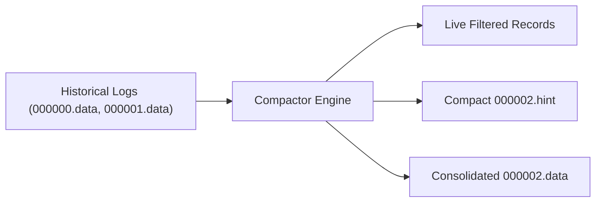

# Bitcask Log-Structured Storage Architecture

Caisson implements a high-performance, log-structured merge storage engine based on the Bitcask design. It transforms random write workloads into sequential disk operations, delivering sustained throughput and sub-millisecond point reads.

---

## 1. Core Design Principles

Traditional B-Trees incur heavy random disk I/O and write amplification due to in-place page updates. Bitcask adopts an append-only log-structured architecture:

1. **Sequential Append Writes**: All mutations (inserts, updates, and deletes) are appended to the active data file. The operating system disk buffer cache and NVMe controllers can write sequentially at maximum hardware bandwidth.
2. **In-Memory KeyDir Index**: All object keys, active file IDs, value byte offsets, and record sizes reside in an in-memory Robin Hood hash table.
3. **Single Disk Seek Reads**: Every read requires at most a single direct disk seek to the exact byte offset of the data file, avoiding index traversal latency.
4. **Fast Crash Recovery via Hint Files**: Compaction generates compact `.hint` files containing only key positions, allowing cold boot in milliseconds without scanning gigabytes of data files.

---

## 2. On-Disk Binary Record Layout

Every record appended to a `.data` WAL file has a fixed 28-byte header followed by variable-length key and value payloads.

### Binary Header Structure

```text
 0                   1                   2                   3
 0 1 2 3 4 5 6 7 8 9 0 1 2 3 4 5 6 7 8 9 0 1 2 3 4 5 6 7 8 9 0 1
+-+-+-+-+-+-+-+-+-+-+-+-+-+-+-+-+-+-+-+-+-+-+-+-+-+-+-+-+-+-+-+-+
|                       CRC32C Checksum                         |
+-+-+-+-+-+-+-+-+-+-+-+-+-+-+-+-+-+-+-+-+-+-+-+-+-+-+-+-+-+-+-+-+
|                                                               |
+                       Timestamp (8 Bytes)                     +
|                                                               |
+-+-+-+-+-+-+-+-+-+-+-+-+-+-+-+-+-+-+-+-+-+-+-+-+-+-+-+-+-+-+-+-+
|                           Key Size                            |
+-+-+-+-+-+-+-+-+-+-+-+-+-+-+-+-+-+-+-+-+-+-+-+-+-+-+-+-+-+-+-+-+
|                                                               |
+                       Value Size (8 Bytes)                    +
|                                                               |
+-+-+-+-+-+-+-+-+-+-+-+-+-+-+-+-+-+-+-+-+-+-+-+-+-+-+-+-+-+-+-+-+
|   IsDeleted   |                   Reserved                    |
+-+-+-+-+-+-+-+-+-+-+-+-+-+-+-+-+-+-+-+-+-+-+-+-+-+-+-+-+-+-+-+-+
|                           Key Bytes...                        |
+-+-+-+-+-+-+-+-+-+-+-+-+-+-+-+-+-+-+-+-+-+-+-+-+-+-+-+-+-+-+-+-+
|                          Value Bytes...                       |
+-+-+-+-+-+-+-+-+-+-+-+-+-+-+-+-+-+-+-+-+-+-+-+-+-+-+-+-+-+-+-+-+
```

### Field Definitions
* **CRC32C (4 Bytes, Big-Endian)**: Castagnoli 32-bit checksum calculated over the entire record payload ($\text{Key} \parallel \text{Value}$).
* **Timestamp (8 Bytes, Big-Endian)**: Unix epoch seconds recording when the mutation occurred.
* **Key Size (4 Bytes, Big-Endian)**: Length of the key in bytes (up to 256 bytes).
* **Value Size (8 Bytes, Big-Endian)**: Length of the value payload in bytes (supporting multi-gigabyte object streams).
* **IsDeleted (1 Byte)**: Tombstone deletion marker (`0` = active record, `1` = tombstone deletion).
* **Reserved (3 Bytes)**: Zero-padded alignment bytes.

---

## 3. Robin Hood KeyDir Index

To ensure deterministic $O(1)$ read performance with minimal memory overhead, Caisson implements an in-memory Robin Hood open addressing hash table for the KeyDir.

### The Robin Hood Principle
In standard linear probing, hash collision clustering causes high variance in search latency. Robin Hood hashing equalizes probe sequence lengths (PSL) by "taking from the rich and giving to the poor":
* When inserting a key, if the current element has a smaller PSL than the incoming key, the incoming key takes the slot and the existing element is pushed down.
* This drastically bounds the maximum PSL and search variance across high load factors (up to 85%).

### KeyDir Entry Layout
Each slot in the KeyDir occupies 40 bytes:
* `key_hash` (uint32)
* `file_id` (uint32)
* `val_pos` (uint64)
* `val_size` (uint64)
* `timestamp` (int64)
* `key_ptr` and `key_len` (16 bytes)

---

## 4. Background Compactor and Hint Files

As objects are updated or deleted, stale records accumulate in older `.data` files. Caisson's compactor runs periodically or on demand:



1. The compactor reads historical immutable data files sequentially.
2. For each record, it queries the KeyDir. If the record is tombstoned or superceded by a newer timestamp, it is discarded.
3. Live records are written to a consolidated new data file.
4. Concurrently, a `.hint` file is generated containing only the key metadata and byte offsets.

### Hint Record Binary Format
```text
[Timestamp: 8B][KeySize: 4B][ValSize: 8B][ValPos: 8B][Key Bytes: KeySize B]
```

On server restart, Caisson reads the tiny `.hint` files directly into RAM in under 5 milliseconds, avoiding the need to parse gigabytes of raw data payloads.

---

## 5. Performance Benchmarks

Measured on Apple Silicon arm64 (single NVMe disk):

| Workload | Records | Payload Size | Latency | Throughput |
|:---|:---:|:---:|:---:|:---:|
| Sequential WAL Append | 1,000 | 4 KB | 14.3 ms | **272.86 MB/s (69,852 IOPS)** |
| KeyDir Point Read | 1,000 | 4 KB | **11.2 μs** | **89,166 IOPS** |
| Compaction Read-Filter-Write | 10,000 | 4 KB | 118.5 ms | **337.55 MB/s** |
