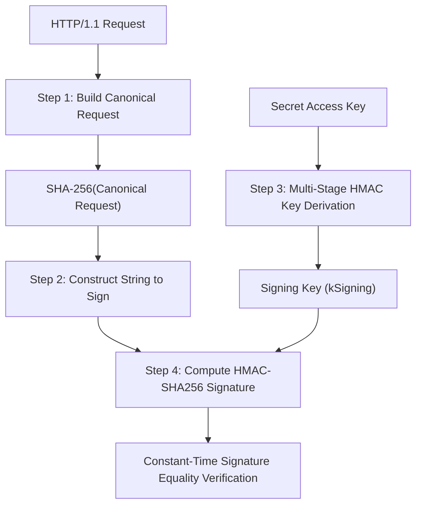

# AWS Signature Version 4 (SigV4) Specification

Caisson implements the complete AWS Signature Version 4 authentication algorithm, ensuring native interoperability with the AWS CLI, AWS SDKs, boto3, and MinIO clients.

---

## 1. Overview of the 4-Step Signing Pipeline



---

## 2. Step 1: Canonical Request Construction

The canonical request formats the HTTP request components into a standardized representation:

```text
<HTTPMethod>\n
<CanonicalURI>\n
<CanonicalQueryString>\n
<CanonicalHeaders>\n
<SignedHeaders>\n
<HashedPayload>
```

### Components
1. **HTTPMethod**: Uppercase HTTP method (`GET`, `PUT`, `POST`, `DELETE`, `HEAD`).
2. **CanonicalURI**: Absolute path, normalized with URI encoding (`/bucket/file.txt`).
3. **CanonicalQueryString**: Query parameters sorted lexicographically by encoded key name.
4. **CanonicalHeaders**: Lowercase header names sorted alphabetically, followed by `:` and trimmed values:
   ```text
   host:s3.amazonaws.com\n
   x-amz-date:20261107T120000Z\n
   ```
5. **SignedHeaders**: Semicolon-delimited list of lowercase header names included in the signature (`host;x-amz-date`).
6. **HashedPayload**: Hex-encoded SHA-256 hash of the request body (or `"UNSIGNED-PAYLOAD"`).

---

## 3. Step 2: String to Sign Construction

The string to sign packages the canonical request hash with timestamp and credential scope metadata:

```text
AWS4-HMAC-SHA256\n
<RequestDateTime>\n
<CredentialScope>\n
<HashedCanonicalRequest>
```

### Format
* **RequestDateTime**: Basic ISO 8601 format (e.g. `20261107T120000Z`).
* **CredentialScope**: `Date/Region/Service/aws4_request` (e.g. `20261107/us-east-1/s3/aws4_request`).
* **HashedCanonicalRequest**: `Hex(SHA256(CanonicalRequest))`.

---

## 4. Step 3: Multi-Stage Key Derivation

Instead of signing directly with the raw secret access key, AWS SigV4 derives a date-, region-, and service-scoped signing key using recursive HMAC-SHA256:

$$\begin{aligned}
k_\text{Date} &= \text{HMAC}(\text{"AWS4"} \parallel \text{SecretKey}, \text{Date}) \\
k_\text{Region} &= \text{HMAC}(k_\text{Date}, \text{Region}) \\
k_\text{Service} &= \text{HMAC}(k_\text{Region}, \text{Service}) \\
k_\text{Signing} &= \text{HMAC}(k_\text{Service}, \text{"aws4\_request"})
\end{aligned}$$

This ensures that compromised signing keys cannot be reused across different calendar dates, regions, or services.

---

## 5. Step 4: Signature Verification

The final expected signature is computed as:

$$\text{Signature} = \text{Hex}(\text{HMAC}(k_\text{Signing}, \text{StringToSign}))$$

### Constant-Time Verification
To prevent side-channel timing attacks that infer secret bytes based on variable-time string comparisons, Caisson compares signatures in constant time:

```c3
fn bool constant_time_compare(String a, String b) {
    if (a.len != b.len) return false;
    char diff = 0;
    for (usz i = 0; i < a.len; i++) {
        diff |= (a[i] ^ b[i]);
    }
    return diff == 0;
}
```
